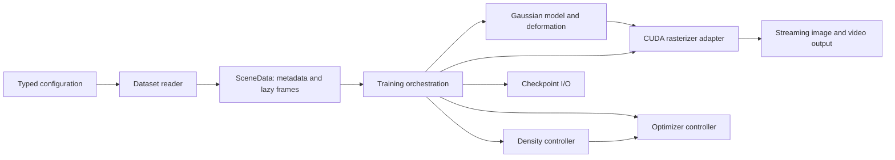

# Architecture

The command layer composes Hydra configuration and calls ordinary Python
functions. Importing `fourdgs` does not initialize CUDA, parse arguments, open
sockets, or read datasets.

## Contracts and ownership

- `data`: readers return `SceneData`, whose datasets return `FrameSample`.
  `Camera` stores a float32 world-to-camera matrix using column vectors and
  positive camera Z. Its projection method adapts to the rasterizer's transposed
  matrices. Timestamps retain each dataset's original normalization.
- `models`: `GaussianModel` owns learnable positions, SH coefficients, log
  scales, raw wxyz rotations, opacity logits, and the deformation network.
  `attributes(time, stage)` returns unactivated values for rendering or export.
- `rendering`: the rasterizer boundary applies activations and returns a
  `RenderResult`, including the screen-space tensor whose gradient drives
  densification. Native extensions are imported only when needed.
- `training`: the optimizer controller owns Adam state and point-parameter
  replacement. The density controller owns accumulated gradients and radii.
  Both must change together when points are appended or removed.
  The sampler keeps its own RNG state and committed batch cursor. Its shuffle
  draws mirror the original DataLoader's post-initialization RNG sequence;
  worker prefetching does not advance the saved cursor.
- `io`: checkpoints, PLY, and legacy conversion have no training-loop logic.
  Checkpoints use a versioned dictionary and atomic replacement. Legacy imports
  provide weights, not an assertion of exact continuation.
- `evaluation` and `preprocessing`: explicit workflows with bounded image
  memory and explicit output locations. Readers never preprocess implicitly.

## Extending the package

To add a dataset, implement `load(config, *, load_points=True) -> SceneData` and
register it with `register_reader`. Supply CPU frame metadata and a lazy image
path; keep format-specific pose conversion in the reader. Add fixtures that
verify projection, timestamps, split membership, and that reading creates no
files. The trainer must not acquire another dataset-format branch.

To change deformation, retain the raw `GaussianAttributes` contract. Add the
configuration fields to `ModelConfig`, and define optimizer parameter groups
explicitly. Existing state-dict names are retained where useful for original
weight import; the unused legacy time network is retained for initialization
and checkpoint compatibility and is documented as such.

To add a loss, extend `LossConfig` and `training_loss`; test both values and
gradients on small tensors. Keep stage-dependent weighting explicit. The
existing loss preserves the upstream L1-plus-DSSIM weighting rather than
silently changing it to a convex combination.

## Paths and configuration

`data.root` is mandatory. Dataset-relative fields (`images`, `point_cloud`,
`sparse`) resolve against it; absolute overrides are also accepted. Hydra does
not change the working directory. Presets contain no local dataset roots.
Neu3D `data.images` may contain `{camera}`, for example
`data.images='rgb/2x/{camera}'`. This supports prepared data without copying it
into a prescribed directory tree.

The package contains its presets so installed commands work from any directory.
Family defaults inherit the typed schema; scene presets contain only overrides.
Use Hydra's `--config-dir` or `hydra.searchpath` to add experiment configuration
outside the package. Explicit command-line overrides take precedence.

## Numerical conventions

The HexPlane AABB retains the original maximum/minimum ordering and therefore
the original reversed spatial normalization. Quaternion ordering is wxyz.
Gaussian PLY stores opacity logits and log scales, not their activated values.
Fine-stage PLY export includes deformed opacity.

The training reporter retains the original per-channel PSNR average; standalone
image evaluation computes PSNR over the full RGB image. LPIPS retains the
original implementation's inputs and weights. These distinctions matter when
comparing previously published metrics.

Training reports and checkpoints describe completed updates. Upstream subset
reports ran before densification and the optimizer update, so interim scores at
densification steps are not directly comparable. Full benchmark evaluation uses
the completed final model in both implementations.
